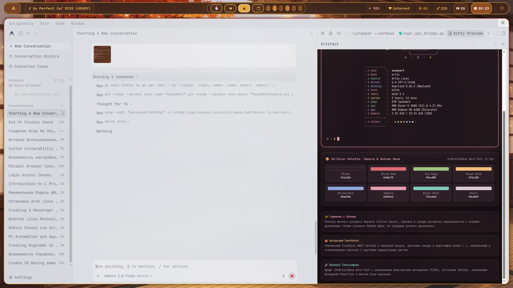

# 🍁 SnayWart's Dotfiles

> **Aesthetic, ultra-lightweight and modular Hyprland rice with Warm Autumn Kemono/Kitsune theme on Artix Linux (OpenRC).**



---

## ✨ Features

- **Window Manager:** [Hyprland](https://hyprland.org/) configured with modular **Lua** (`~/.config/hypr/hyprland.lua`).
- **Status Bar:** [Waybar](https://github.com/Alexays/Waybar) with pill-shaped modules, dynamic workspace icons, sound controls and popups.
- **App Launcher & Menus:** [Rofi](https://github.com/davatorium/rofi) (Wayland fork) themed for:
  - App Launcher (`Super + Space`)
  - Control Center (`Super + I`)
  - Power Menu (`Super + X`)
  - Interactive Wi-Fi selector
  - Live Wallpaper Gallery (`Super + W`)
- **Terminal:** [Kitty](https://sw.kovidgoyal.net/kitty/) with custom prompt (`󰄛 ~ ❯`) and Fastfetch on startup.
- **Lockscreen:** [Hyprlock](https://wiki.hyprland.org/Hypr-Ecosystem/hyprlock/) with clock, password prompt and pill power buttons.
- **Notifications:** [Mako](https://github.com/emersion/mako) notification daemon with matching palette.
- **File Manager:** Thunar with full dark theme and GTK bookmarks.

---

## ⌨️ Keybindings

| Shortcut | Action |
|---|---|
| `Super + Return` | Open Kitty Terminal |
| `Super + Space` | Open Rofi App Launcher |
| `Super + Q` | Close Active Window |
| `Super + E` | Open Thunar File Manager |
| `Super + I` | Open Control Center |
| `Super + X` | Open Power Menu |
| `Super + W` | Open Wallpaper Gallery |
| `Super + V` | Open Clipboard History |
| `Super + L` | Lock Screen (`hyprlock`) |
| `Super + Shift + S` | Area Screenshot |
| `Super + 1..9` | Switch Workspace |
| `Super + Shift + 1..9` | Move Window to Workspace |

---

## 📁 Repository Structure

```text
dotfiles/
├── .config/
│   ├── hypr/          # Hyprland modular Lua config, scripts, wallpapers
│   ├── waybar/        # Waybar capsules layout and styling
│   ├── rofi/          # Rofi themes (launcher, wifi, power, wallpapers)
│   ├── kitty/         # Kitty terminal configuration
│   ├── mako/          # Notifications styling
│   ├── fastfetch/     # System fetch layout
│   ├── gtk-3.0/       # Dark GTK3 styling and bookmarks
│   └── gtk-4.0/       # Dark GTK4 styling
├── .bashrc            # Bash configuration and aliases
├── install.sh         # Automatic symlinking installer
├── preview.png        # Desktop screenshot
└── README.md
```

---

## 🚀 Installation

Clone the repository and run the installer script:

```bash
git clone https://github.com/SnayWart/dotfiles.git ~/dotfiles
cd ~/dotfiles
chmod +x install.sh
./install.sh
```

---

## 🎨 Wallpapers

Includes curated autumn-themed artworks located in `~/.config/hypr/wallpapers/`:
- Autumn Kemono Scenic
- Autumn Shrine Kitsune
- Autumn Sunset Fox
- Autumn Tingyun Fox
- Autumn Japanese Maple & Saga Leaves

---

*Crafted with ❤️ on Artix Linux.*
